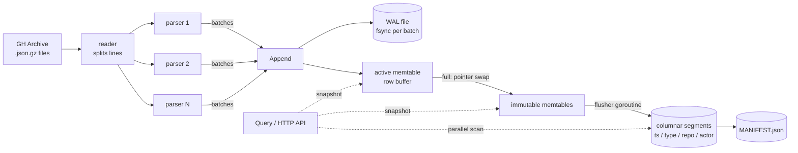

# ghstore

[](https://github.com/Meetp369/ghstore/actions/workflows/ci.yml)

A small, crash-safe event store in Go that ingests [GH Archive](https://www.gharchive.org/) (the public log of all GitHub activity) and answers time-range group-by queries, such as *"top 10 repos by push events between 09:00 and 15:00"*.

It uses the same basic idea as HTAP databases: writes land in a fast **row buffer** backed by a **write-ahead log**, and a background goroutine **compacts** full buffers into **columnar segments** that are cheap to scan. Queries read both at once and see every row exactly once.

## Architecture



**Write path.** `Append` writes a batch to the active WAL file (one CRC-checked record per batch, fsynced), then to the active in-memory buffer. When the buffer reaches `-flush-rows` rows (default 200,000), it is **rotated**: under a short lock it moves to an immutable list and a fresh buffer + WAL file replace it. Writers never wait on disk compaction.

**Compaction.** One background goroutine takes the oldest immutable buffer and:

1. writes it as a segment directory (rows sorted by timestamp, one file per column, strings dictionary-encoded) into a temp dir, fsyncs, renames it into place;
2. atomically replaces `MANIFEST.json` (write temp, fsync, rename), recording the segment and the WAL ID it came from;
3. swaps the buffer for the segment under the lock;
4. deletes the buffer's WAL file.

**Queries.** A query takes a snapshot of (segments, immutable buffers, active buffer) under a read lock and then runs without holding it. Step 3 above is a single swap under the write lock, so a snapshot sees each row in its buffer **or** its segment, never both and never neither. Segments whose `[min_ts, max_ts]` does not overlap the query are skipped; the rest are scanned in parallel by a worker pool, each worker counting into a private map. Inside a segment, rows are sorted by time, so the matching range is found with two binary searches, and counting uses dictionary codes (a slice index) instead of hashing strings.

**Recovery.** On startup:

| Crash happened... | On disk | Recovery does |
|---|---|---|
| mid-append | torn last WAL record | CRC/length check drops the partial batch; complete batches kept |
| before a flush | rows only in WAL | replays the WAL into a buffer, re-flushes it |
| after segment write, before manifest | orphan segment dir | deletes dirs not listed in the manifest; rows replayed from WAL |
| after manifest, before WAL delete | rows in segment **and** WAL | deletes WAL files with ID ≤ `flushed_wal`; no duplicates |

## Design decisions

- **Row buffer + columnar segments.** Appending to a row buffer is cheap; scanning one column of a segment is cheap. Converting in the background gets both. This is the same trade-off SingleStore makes with its rowstore and columnstore.
- **Pointer swap instead of copying.** Rotation moves a pointer to the immutable list, so the write lock is held for microseconds. The flusher reads the immutable buffer without any lock because nothing writes to it again.
- **One flusher, in WAL order.** Flushing oldest-first makes `flushed_wal` a single increasing number, which is all recovery needs to decide which WAL files are obsolete.
- **Batch = unit of durability.** One WAL record per batch, with a CRC, means a batch is recovered completely or not at all.
- **Sort segments by time.** Makes time-range filtering two binary searches and makes min/max segment skipping effective.
- **Dictionary encoding.** Repo and actor names repeat heavily; storing a 4-byte code per row shrinks segments and turns group-by into array increments.

## Usage

```bash
make build

# Real data: one day of GH Archive (24 hourly files, a few GB compressed)
./scripts/download.sh 2024-01-01 ./gh

./bin/ghstore ingest -data ./data ./gh/*.json.gz          # prints events/sec
./bin/ghstore stats  -data ./data
./bin/ghstore query  -data ./data -group-by repo -type PushEvent \
    -from 2024-01-01T09:00:00Z -to 2024-01-01T15:00:00Z -limit 10

# HTTP API
./bin/ghstore serve -data ./data -addr :8080
curl 'localhost:8080/query?group_by=repo&type=PushEvent&from=2024-01-01T09:00:00Z&to=2024-01-01T15:00:00Z&limit=10'
curl localhost:8080/stats
gzip -c events.json | curl -X POST -H 'Content-Encoding: gzip' --data-binary @- localhost:8080/ingest
```

No network? `./bin/ghgen -out ./gen -hours 24 -per-hour 420000` writes synthetic files in the same format.

## Testing

```bash
make race    # all tests with the race detector
make crash   # kill -9 a real writer 20 times at random points, verify recovery
```

The suite has 65 test functions (111 including table-driven subtests), covering WAL torn-tail handling at every byte offset, segment encoding, query correctness across segments and buffers, each crash case in the table above, concurrent appends + queries + compaction under `-race` (asserting no row is ever counted twice mid-flush), the ingest pipeline and the HTTP API.

`TestKill9Recovery` starts a real writer process, SIGKILLs it after a random number of acknowledged batches (often mid-flush), reopens the store, and checks that every acknowledged row is present exactly once.

## Results

How each number is measured:

| Metric | Command | Notes |
|---|---|---|
| Ingest throughput | `ghstore ingest` | events / wall-clock seconds, including gzip, JSON parsing, WAL fsync and compaction |
| Rows stored | `ghstore stats` | `total_rows` |
| Query p95 | `ghbench -queries 1000` | 1,000 random queries: random group-by column, random window (1 h to 24 h), 50% with a type filter |
| Tests | `go test -v ./... \| grep -c '^--- PASS'` | top-level test functions |

Development run on **synthetic** data (`ghgen`, 24 h x 420k events), 2-vCPU cloud VM, Go 1.24:

| Metric | Value |
|---|---|
| Ingest | 105,500 events/sec (10.08M events in 95.5 s) |
| Rows stored | 10,080,000 in 51 segments (227 MB on disk) |
| Query latency | p50 43 ms, **p95 237 ms**, p99 300 ms |
| Kill -9 recovery | 20/20 runs, 0 acknowledged rows lost, 0 duplicates |

<!-- TODO: replace with a run on real GH Archive data and your machine's specs -->

## Layout

```
cmd/ghstore     CLI: ingest, serve, query, stats
cmd/ghbench     query latency benchmark
cmd/ghgen       synthetic GH Archive-format data generator
internal/event  event model, GH Archive parsing, binary encoding
internal/wal    write-ahead log with CRC32C records
internal/segment columnar segment format, group-by scan
internal/store  buffers, rotation, background compaction, recovery, queries
internal/ingest worker-pool ingest pipeline
internal/server HTTP API
```

## Limitations

Single node; append-only (no updates or deletes); segments are never merged with each other; segments are fully loaded into memory on open; one filter per query.
